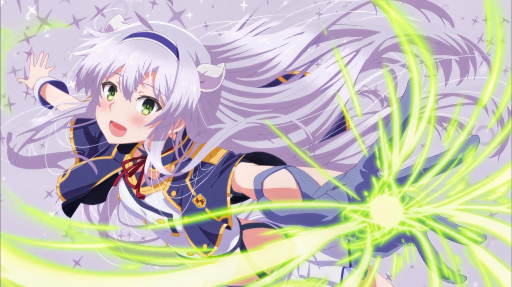

# Waifu

<html lang="id">
<head>
<meta charset="UTF-8">
<meta name="viewport" content="width=device-width, initial-scale=1.0">
<title>Sistine Fibel | Anime Profile</title>

</head>

<body>

<header>
  
SISTINE.

  <nav>
    <a href="#home">Home</a>
    <a href="#profil">Profil</a>
    <a href="#musik">Musik</a>
  </nav>
</header>

  

    <small>ANIME CHARACTER PROFILE</small>

    <h1>SISTINE FIBEL.</h1>

    

      The White Cat of Alzano Imperial Magic Academy.
      A beautiful magician with silver hair and
      emerald eyes.
    

    <a href="#profil" class="btn">
      Explore Profile ↘
    </a>
  

  

    

    

    

    

  

<section id="profil">
  <h2>About Sistine</h2>

  

    
Nama: Sistine Fibel

    
Julukan: White Cat

    
Rambut: Perak

    
Mata: Hijau

    
Anime: Akashic Records of Bastard Magic Instructor

  

</section>

<section id="musik">
  <h2>Anime Music</h2>

  

    

      <h3>🎧 Favorite Music</h3>
      
Putar musik favoritmu.

    

    <button id="playBtn" onclick="toggleMusic()">
      ▶ Play Music
    </button>

    <audio id="audio" loop>
      <source src="18.mp3" type="audio/mpeg">
    </audio>
  

</section>

<footer>
  © 2026 | Sistine Fibel Anime Profile
</footer>

</body>
</html>
